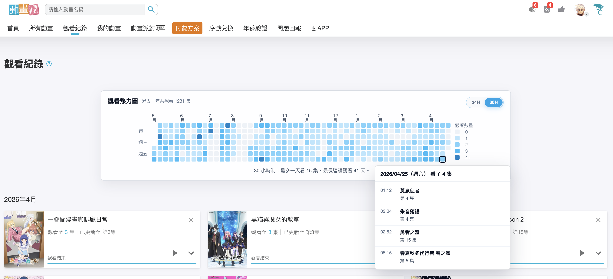

# Bahamut Anime Watch Recap（動畫瘋追番回顧）

Browser extension for `ani.gamer.com.tw` that turns the available year of watch history into a heatmap, explainable behavior analysis, and a presentation-style personal recap. It was previously named Bahamut Anime Watch Heatmap.

## Features

- Hover a heatmap day to see watched titles, episode labels, and watch times.
- Switch watched days between calendar days (`24H`) and a late-night-friendly 6 a.m. boundary (`30H`). Official release dates always use natural Asia/Taipei calendar boundaries.
- Open **看分析** to choose either the watch-time axis or official-release-time axis, then explore the past 30 days, past 365 days, recent calendar months, recent seasons, or calendar years.
- See actual release-season distribution, viewing rhythm, known episode-length totals, longest episodes, release-to-watch delay, behavior preference, tags, makers, directors, publishers, and a comparison with the platform popularity snapshot captured when metadata was retrieved. Tags, makers, directors, and publishers are ranked by how many series you watched, then by episodes.
- Compare completed single-season binges by average episodes per day in watch-time analysis. The dashboard also offers elapsed-time sorting and each work's full start-to-finish date range, even across months; a recap chapter and summary tile highlight daily viewing rates only when eligible seasons exist.
- Play the same analysis pipeline as a full-screen recap for a rolling range, month, season, or year. A calendar-year release recap is assembled from winter, spring, summer, and autumn without double-counting a series across seasons.
- The recap plays on one persistent stage: the background, progress bar, and controls stay put while only the foreground of each chapter moves, so chapters flow into each other instead of cutting. Navigation is never blocked by an animation; use the buttons, the arrow keys, the progress segments, or click the left or right side of the screen.
- The recap ends on a one-screen summary poster that recalls every chapter as a tile with its own color and jumps back to any chapter when you click its tile. It adds a day-by-day calendar of the period, a rule-based viewing type, and at most two highlights that appear only when the history supports them, such as the episode playing across New Year's midnight, a night that ran past dawn, or a period spent catching up on older series. On screens larger than 1440×900 the poster keeps its layout and scales up as a whole instead of stretching. Chapters that lack data are left out rather than shown as zeros.
- Use the analysis header to clear only the extension's metadata cache and retrieve it again. Watch history, the saved history cache, and the day-boundary preference are not deleted.
- Download a local debug JSON from the analysis header. It contains analysis-ready watch and metadata rows plus history-loading, cache, negative-record, progress, and rate-limit diagnostics; it never includes cookies, the account ID, or login credentials.

Both the heatmap and the full-screen analysis UI live in Shadow DOM. Their styles do not leak into Bahamut Anime, and hostile page CSS cannot restyle the extension UI.

## Metadata and Analysis Rules

Release times and catalog facts come from Bahamut's first-party episode metadata API. The response is normalized into one cached episode record and one cached anime record instead of repeating the complete anime payload for every episode.

Watched episode IDs are resolved first. Each successful watched response identifies its exact `anime.episodes` playback group; only references inside those observed groups enter the lower-priority discovery queue. Unstarted groups from the same anime index are not fetched. Every observed group expands to a fixed point, is globally de-duplicated, and still goes through the same extension-wide ten-request rolling limit. These started-group timelines are used only where logically required, such as proving which episodes were genuinely pending at a decision moment.

- Each episode's `upTime` is the primary fact used to assign winter, spring, summer, or autumn. `seasonStart` and `seasonEnd` are only series-level boundary and consistency evidence; they never override episode release dates.
- `duration` is the length of the episode, not proof of time spent playing it. It is summed once per selected watch record for content-length totals and rankings. A value is called a total only when duration coverage for the selected events is 100%; otherwise the UI shows the known subtotal and does not extrapolate from an assumed episode length.
- Release footprints describe only the selected episodes that the user actually watched. They are not presented as the complete airing structure of a series.
- A playback group can become a pending choice only after its first observed watch. Episodes must be released strictly after that start and still be available at the decision moment; earlier episodes are never retroactively labeled backlog. Multiple API playback groups remain isolated because their semantics are not guessed, and same-series continuation within 60 minutes is excluded as a new preference decision.
- Platform score, review count, and popularity are labeled with their retrieval time. They are current snapshots, not historical values from when the user watched an episode, and popularity ranks are only within the metadata-covered comparison set.
- Missing, malformed, or internally inconsistent facts—including a release time later than the recorded watch—are excluded instead of guessed. Each ranking and recap chapter uses the facts available to that result, so a missing record does not hide unrelated insights.
- API placeholders map to unknown rather than failing the record: an empty or `0000/00/00` series date is null. The open-ended `2100/12/31` season end is also null as a date, and it is what marks a series as still airing; the API `flag` field is not used for that. A date-only `downTime` becomes Asia/Taipei 00:00 of that day, a lower bound for availability. Episode labels such as 0 (prologue) or 9.5 (special) are kept as facts. Completion and binge rankings require one unambiguous, contiguous main-episode group matching the catalog count, including continuation numbering such as 13–24. Playback-group preference timelines still require numbering exactly 1 through `totalEpisode`.
- Binge eligibility uses official ending dates and the still-airing mark above before inference from observed viewing. Completion is attributed to the watch period containing the final missing episode; earlier watches remain part of the elapsed time, and later watches cannot complete an earlier period. Daily averages divide episode count by the inclusive 24H/30H date span, including idle days. These are journeys observed in available history, not lifetime first completions or measured playback duration. Separate seasons remain separate works.
- Each started series that has finished airing gets one outcome. It is finished when every main episode was watched. Otherwise it is nearly finished with at most two episodes left, dropped when less than half was watched, and midway in between. A series whose first episode is not in the history is not judged, because it may have been started before the history begins. A series still airing is reported as caught up or behind instead. Drop rates by tag use only tags with at least eight started series.
- In a calendar-year recap, "watched first when there was a choice" is computed again for each season. A season lists up to three series, and only when it has at least eight such choices; each listed series was compared at least three times and opened first at least half the time. Other periods use the same per-series rule on the whole period.
- One of those favorites is called a hidden gem only when it has finished airing and its platform popularity ranks in the bottom third among at least eight watched series that premiered in the same season. Popularity keeps accumulating, so it is compared only within one premiere season; a premiere up to seven days early counts toward the next season. Most periods have no hidden gem, and its chapter and tile are then left out.
- Highlights use the watch-time axis. The New Year's Eve moment looks at watches from 22:00 to 03:00 around midnight and requires history covering that window. A dawn night starts by 03:00, has no gap longer than 60 minutes, and ends between 06:00 and 10:00. An older series premiered at least two years before it was watched and was either uploaded at least two years before the watch or put online as a batch within 30 days. Older series are highlighted only when there are at least five of them or they make up at least a quarter of the watched episodes whose premiere date is known.

One extension service worker owns metadata fetching for all open tabs. Combined request starts are limited to ten in every rolling one-second window, and the grants are stored in session storage so restarting the Manifest V3 worker does not reset the active budget. Requests use `credentials: "omit"`; account-oriented response fields such as `favorite`, `star`, and `userReviewId` are not used or stored.

### Caching

- Episode records stay until the metadata cache is cleared; anime catalogs and airing facts are refreshed on the next lookup after 24 hours. A refreshed catalog is shared by its cached episodes. A known unavailable answer ("license expired") is reused for one day, four times longer after each refetch that confirms it, up to seven days, with a fixed per-episode jitter of ±20% so expiries spread out. A response identified as the requested episode whose fields fail validation is reused for 24 hours and only while the parser version is unchanged. Network and HTTP errors (including 429), empty or placeholder `data`, and responses for another episode are never cached.
- Watch history is stale-while-revalidate. On a revisit the heatmap and analysis start immediately from the history saved for the logged-in account (keyed by a SHA-256 hash of the account ID), and both the 365-day window and coverage end at that snapshot rather than now. The page is then read again. Paging stops early once every row of the newest page predates the snapshot and matches it within the label's precision, every newer saved watch has already reappeared, and every watch saved only to the hour has been read again; the rows read so far then replace their saved copies. Without that proof, without a saved copy, or when the last full read is a week old, paging continues until the 365-day window or the history ends and the rows read replace the saved copy. A history that ends before saved watches younger than 330 days ended early: those watches are kept, and the read counts as neither complete nor a full read. Metadata is collected again only when the shown watches changed, and a failed refresh keeps the saved history on screen.
- A page's relative labels such as `5 分前` are measured from when that page was fetched, and its coverage ends at the first render, so re-reading after "顯示更多" never shifts older rows. A page whose logged-in account changed after it loaded, or that is older than a read another tab already saved, is not read or saved.
- Clearing the metadata cache keeps the saved history.

Privacy policy: [PRIVACY.md](./PRIVACY.md)



## Development

```sh
pnpm install
pnpm test
pnpm typecheck
pnpm build
```

## Package for Publishing

```sh
pnpm package
```

The publishable browser extension zip is written to `release/`.
Upload that zip in the Chrome Web Store Developer Dashboard.

Chrome Web Store listing assets are in `assets/store-listing/chrome/`:

- `small-promo-440x280.png`
- `marquee-1400x560.png`
- `screenshot-1280x800.png`

Run `pnpm assets:store` to regenerate the extension icons and crop the store listing images from `assets/screenshot.png`.

## Load Locally

1. Run `pnpm build`.
2. Open Chrome or Edge extension settings.
3. Enable developer mode.
4. Load the generated `dist/` directory as an unpacked extension.
5. Visit the [Bahamut Anime watch history page](https://ani.gamer.com.tw/viewList.php) while logged in.
